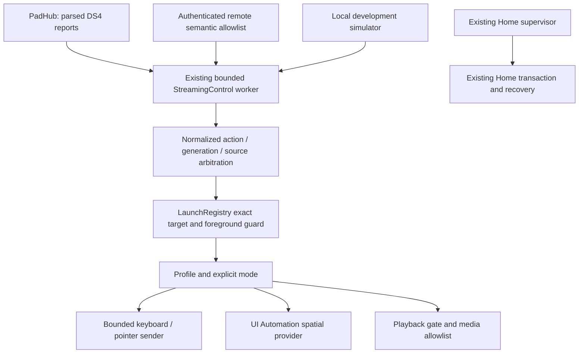

# S2.3 TV Navigation Engine

Engineering scope: extend the S2.0 native streaming bridge rather than introduce another controller sink, tracker or Home implementation. The candidate is 0.11.0-rc.1; it is not a stable or hardware-accepted release.

The normalized contract identifies source, action, monotonic timestamp, generation, optional hashed controller identity, repeat state, target session and routing decision. Neither simulator nor remote supplies an HWND, process ID, executable, arbitrary key or page script. Native receipts report a command outcome; UIA focus and native audio readback can provide narrower observed effects. Sending a playback shortcut is never a playback-state acknowledgment.

## Responsibilities

- `pad_hub` and `controller_supervisor`: authoritative physical input and Home policy, including existing fallback selection and reconnect/neutral semantics.
- `streaming_control`: bounded scheduling, source arbitration, generation invalidation, normalized routing, input safety and native simulator commands.
- `tv_navigation`: closed action/mode contract, conservative versioned service profiles and typed diagnostics.
- `edge_cinema`, `launch_registry`, `window_broker`: exact owned launch identity and deliberate focus recovery; no process-name adoption.
- `spatial_navigation`: bounded UIA discovery, geometry scoring and supported SetFocus/Invoke; no page text or guessed coordinate click.
- `ControllerSimulator`: development-only local UI over the same native route, delayed single commands, safe deterministic scenario, cancellation and sanitized export.
- `TvNavigationSettings`: production local mode selection and explicit playback shortcut arm, independent of simulator availability.

## Modes and failures

Automatic currently uses each profile's conservative keyboard strategy, keeping selection stable because no five-service runtime capability probe has established a better default. Keyboard emits one allowlisted command. Spatial must prove current focus and candidate ancestry within the exact managed root; unavailable or stale providers return an error with no automatic confirm/click retry. Pointer translates deliberate controller movement and click/scroll intent into the bounded owned client area. The user selects a recovery mode explicitly.

The native pointer indicator remains nonactivating and click-through. Spatial selection relies on the service/browser's actual focus rendering. A separate VELORA spatial overlay and automatic virtualized-list scrolling are not implemented; their absence is recorded rather than presented as verified behavior.

Configuration/source/session changes revoke old input. Physical reports retain the existing eight-item queue, freshness and neutral-rearm boundaries. Simulator work is bounded, rejects replay/stale generations and can be cancelled; a command already accepted by Windows cannot be undone. Home does not depend on the active navigation mode, an accessibility query succeeding, or a player shortcut working.

## Native safety

Every website action resolves an active service launch and checks HWND, PID, captured process creation time and current foreground. Simulator recovery is deliberate and restricted to the selected owned session. Focus denial is an outcome, not a reason to send into the currently focused unrelated application. Click and scroll require an owned unobscured hit target. Physical modifiers and drags suspend generated input.

Windows `SendInput` has an unavoidable final-check/insertion race and UIPI constraints; it is not a scoped message delivery API. UIA also has a final-check/provider-operation race. The candidate does not enable UIAccess, elevate, hook input globally, modify browsers, inject playback processes or bypass security restrictions. The [Windows input API documentation](https://learn.microsoft.com/en-us/windows/win32/api/winuser/nf-winuser-sendinput) explains the return-value and integrity limits.

The local Tauri application and its CSP/capability boundary are separate from the external Edge site. Simulator mutation additionally requires native development availability and the local main WebView. The authenticated LAN remote retains its existing semantic allowlist and cannot click diagnostic controls marked `data-remote-admin`.

## Media API choice

The repository already uses Windows GSMTC in `music_service` for an explicitly identified Apple Music session. That implementation remains intact. For streaming, the [GSMTC current-session API](https://learn.microsoft.com/en-us/uwp/api/windows.media.control.globalsystemmediatransportcontrolssessionmanager.getcurrentsession) is a system preference, while [SourceAppUserModelId](https://learn.microsoft.com/en-us/uwp/api/windows.media.control.globalsystemmediatransportcontrolssession.sourceappusermodelid) identifies a source app. Neither fact by itself proves this registry-owned service window. The engineering inference is that selecting a generic current browser media session could control another player's audio; S2.3 therefore uses one profile-approved foreground command and reports its effect as unverified. Explicit Windows volume/mute uses the existing Core Audio endpoint identity and readback path. Separate absolute Play/Pause state and exact browser GSMTC session binding remain unavailable in this candidate.

## Evidence

See the navigation audit for the starting state, the spatial and simulator documents for detailed behavior, and the release gate for exact-source tests, runtime observations, artifacts and remaining blockers. Unit tests do not establish service catalog or protected-media compatibility. Physical DualShock 4 acceptance remains blocked until actual hardware testing.
