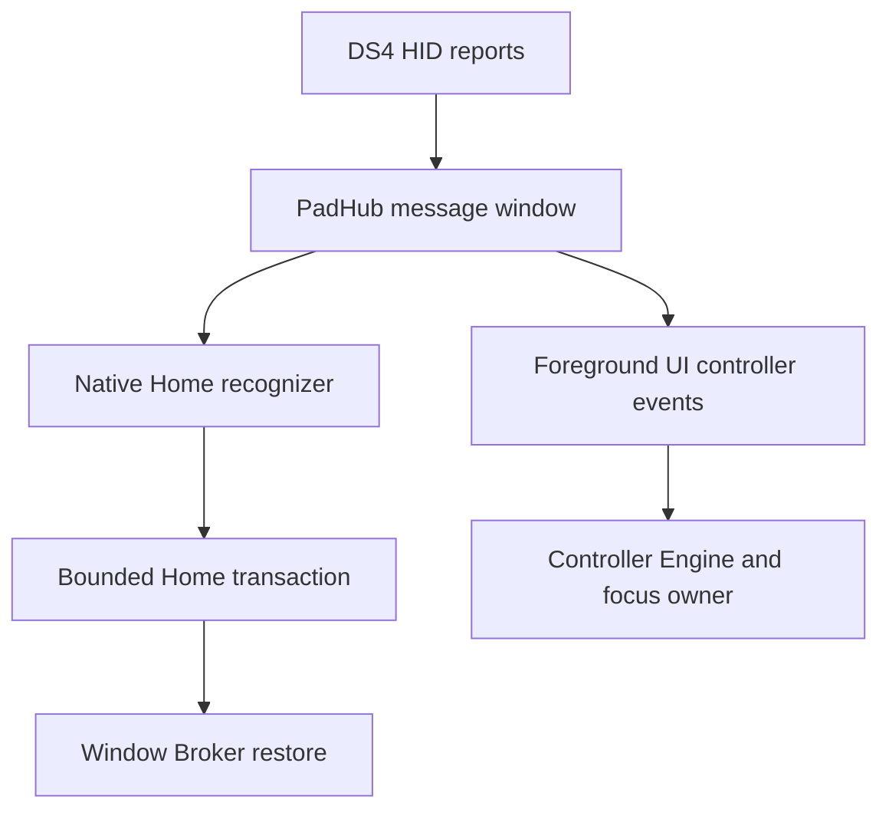

# S2.0 architecture

This document describes the retained architecture and its acceptance boundaries. Source baseline is S1.4 `36dc8c1`; implementation details for the S2 additions are recorded in the controller-supervisor and streaming-control documents. S2 remains a development candidate until hardware acceptance and exact-head CI complete.

## Native input and Home

PadHub owns the only game-controller Raw Input registration for the application lifetime. Windows helpers register background input and device notifications. The message pump, rather than a React focus listener, dispatches reports. Home remains a native semantic action when the WebView loses focus. The frontend receives normal navigation state only in its permitted context and arbitrates native versus browser input; it does not assume streaming sites implement Gamepad API.

S2 adds `controller_supervisor.rs` for the optional per-device deliberate fallback and `streaming_control.rs` for an opt-in bounded native bridge to owned foreground Edge Cinema windows. The bridge receives parsed reports directly from PadHub, not from background React listeners. It translates supported D-pad/tap/pointer/scroll semantics into guarded Windows input. `pointer_indicator.rs` supplies a nonactivating native pointer-mode indication above the current owned streaming window. These additions remain physically unvalidated.

Session-only controller settings must reset on process exit and require neutral input before arming. Background input observation and real foreground restoration are separate diagnostic stages. A successful chord-recognition test is not a successful Home-restoration test.

## Sessions and application ownership

`SessionOrchestrator` models Home, Cinema, Game, Playnite, Desktop and Ambient; `SessionContext` retains per-launch identity and revision. `LaunchRegistry` owns individual launches, including distinct streaming service app IDs. `ProcessTable` records executable process identity and creation time. `WindowBroker` enumerates/scorers windows, observes foreground and validates live ownership before activation or close. An external browser launch PID is not trusted as the only window owner.

Returning Home restores VELORA and retains external sessions. Switching can resume a validated existing streaming window; sessions are not switched by terminating a browser. A close action is distinct from Home, validated against VELORA-owned session identity, and may be refused if ownership no longer matches.

## Remote, recovery and system control

The existing PWA uses the existing HTTPS server and signed command protocol. Authentication, host/origin checks, bounded bodies, replay protection, serialized vault operations and revocation remain required for every added control. A network command cannot masquerade as physical local-controller input. Remote Home uses the conservative `Device` policy.

S2 extends that allowlist with Control Center (`menu`) and the application picker (`switch-apps`). Both first require successful conservative native Home restoration, then enqueue their explicit UI action. Remote Home's subsequent UI event resets UI state only; it does not issue another local unrestricted native restore. Event enqueue is not a rendered-panel acknowledgement.

Control Center uses the existing React focus/dialog model. System volume/mute reuse `music_service`; autostart is an explicit local opt-in; display/audio discovery is read-only. Startup reconciles persisted sessions and service markers. Sleep-gap recovery refreshes tracked launches/windows. No service, driver, global remapping, automatic firewall rule, automatic TV mode or automatic audio-route change is part of this design.

## Isolation and rollback limits

Development uses a separate branch/worktree and a separate candidate executable. Existing single-instance and application-data identities are shared with the installation unless explicitly overridden by a future implementation; copying an EXE is not a separate user-data sandbox. Exit the installed process before a candidate run, verify candidate BuildInfo, then exit the candidate before rollback to installed 0.9.2. Do not install over the existing binary without explicit approval.

## Proof levels

| Evidence | What it establishes | What it cannot establish |
|---|---|---|
| Source inspection | Intended control flow and visible guards | Delivery by real HID/Windows/website |
| Unit/React tests | Parser, policy, timing/state invariants under fixtures | Real controller, Steam, site login or foreground acceptance |
| Windows build | Native compilation/linking | Runtime usability |
| Exact-head CI | Repository checks for one commit | MSI controller/display acceptance |
| User physical workflow and diagnostic capture | Actual observed candidate behavior in the stated setup | General compatibility with every site, device or future website update |
