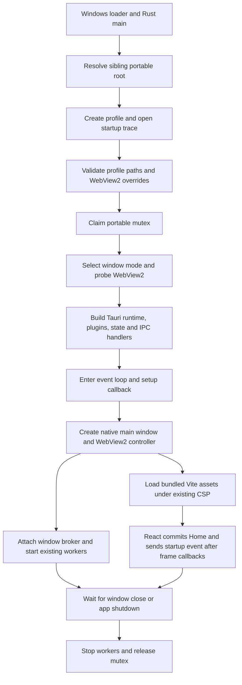

# VELORA 3.0 first-frame recovery

The recovery branch starts at Singularity PR #75 HEAD `e1e801e382d9d2658b4d3403b3f4464be7a98c28`. The historical portable package from [run 45299095584](https://github.com/Milklosz/nexus-aurea/actions/runs/45299095584) matched the published package and executable hashes. Its runner smoke required a surviving process but did not verify React readiness. The no-window and process-exit results from the original MSI test remain valid evidence for those attempts.

## Evidence and hypothesis ranking

| Status | Evidence | Conclusion |
| --- | --- | --- |
| Confirmed | The original setup applied `--windowed` after Tauri attempted configured native window creation in fullscreen. | Both reported attempts could fail on the same fullscreen creation path. Applying mode in the creation config fixes the ordering. |
| Confirmed | The historical GUI-subsystem EXE produced empty console logs during the windowed attempt. Crashpad metadata was written during the fullscreen attempt, with no preserved crash dump. | The first attempt reached WebView2 activity. Its terminal stage and HRESULT are unknown. |
| Confirmed | The historical launcher used a PowerShell execution-policy override. The original acceptance test instead used direct launches with an explicitly redirected environment. | Launcher availability was a separate defect. The CMD launcher now invokes the isolated EXE directly. |
| Confirmed | A fresh re-run of the historical EXE with the verified SHA-256 and isolated data opened a native window and closed with status 0, in both the normal and restricted Codex exec contexts on the MSI. | The original failure has not reproduced. Neither fullscreen ordering nor execution context is established as its cause. |
| Plausible, strongest historical fit | WebView2 environment/controller creation, native window creation, or a setup panic on the first launch. Profile path, transient permissions, and display context can affect those stages. | The new trace separates loader probe, Tauri build, Ready/setup, native creation, and React readiness. |
| Plausible, lower confidence | Another portable mutex holder, missing runtime or DLL, frontend navigation failure, or an early successful return. | The old artifact was x64 with a statically linked loader. Fresh Crashpad metadata makes a duplicate early return less likely for the fullscreen attempt. A frontend-only fault ordinarily leaves a native window. |
| Unverified | Security software interference, physical Panasonic mode, and Bluetooth DualShock 4 identity. | No policy, driver, certificate, or security setting changes were used. |

## Startup path

| Failure path | Outcome and evidence |
| --- | --- |
| OS loader or process termination before Rust | No trace is possible. Capture the launch exit status. |
| Invalid or unavailable portable root | Exit 20 before Tauri. A root that cannot be opened cannot contain a trace. Child-directory and loader override failures log `exit-profile-error` when the root is writable. |
| Duplicate mutex | The new process logs `exit-duplicate-instance` and exits. The existing installed title and mutex are disjoint. |
| Loader or Tauri/plugin initialization | Records loader status, `tauri-build-start`, and a typed terminal error on returned failure. Build failure exits with code 21. |
| `Ready` before creation, setup, or panic | Logs `event-loop-started`, `window-create-start`, `window-created` and `setup-complete` separately. A window build error records its category and HRESULT where available before Tauri handles the fatal setup error. Panic traces omit payloads and filesystem paths. |
| Navigation or React failure | The native window can exist while `page-load-finish` or `frontend-ready` is absent. The CI gate requires both native visibility and frontend readiness. |
| Window close or unexpected exit | A graceful run reaches `shutdown-requested` and `exit-orderly`. For a stopped process without a terminal phase, the last recorded phase and OS exit status are the evidence. |

## Isolation and regression review

- **High, corrected.** The packaged executable previously depended on launcher environment for credential, mutex, profile and autostart isolation. The dedicated build derives its own sibling path before invoking Tauri. The installer workflow does not use this feature.
- **High, corrected.** The native launcher runs without forcing a PowerShell policy override.
- **Medium, corrected.** Initial window flags are set before creation. Failure phases and structured error categories are written to bounded per-process traces. The smoke directory is separate from the package stage and only sanitized startup evidence is published by the smoke job.
- **Medium, corrected.** The portable app rejects conflicting WebView2 data-directory overrides and redirected profile directories. WebView2 policy values are queried read-only. The startup trace omits environment values, paths, URLs, authentication data and panic text.
- **Medium, corrected.** The first recovery build created Claude CLI state in the isolated profile during Home startup. When the status-line file was absent, Home's usage panel ran the host CLI's authentication-status command. The portable build now accepts only the isolated status-line file for this widget. The installed app retains its CLI fallback.
- **Reviewed.** Existing Home, controller worker lifecycle, LAN authentication, credential service and installer flows retain their original call paths. No certificates, drivers, startup settings, or production credentials are involved in startup validation.

## Luna validation on the MSI

1. Download the artifact for the exact recovery commit from the portable Actions run. Match the artifact ZIP digest to GitHub's record and the inner ZIP and EXE SHA-256 values to `velora-portable-manifest.json` before starting either launch. The package contains `SHA256SUMS.txt` and a verified output manifest.
2. Extract into a fresh writable test folder. Record Windows edition/build, laptop model, active display identity/mode and DS4 connection if visible. Record the installed 0.9.2 executable hash before testing.
3. From the extracted folder run `Run-VELORA-Portable.cmd --windowed`. Verify the decorated window, rendered Home, keyboard navigation to another panel and back, and at least 15 seconds of uptime. Close it via the window button or `Alt+F4`. Record the OS exit status and read the newest `VELORA-Portable-Data\startup-*.log`.
4. Run `Run-VELORA-Portable.cmd` for fullscreen. Repeat the render, navigation and clean-close checks. Verify the expected display separately and exercise DS4 navigation and PS+Options Home only when the controller identity is confirmed.
5. For either failure, save the exact artifact/commit, mode, exit status and its sanitized startup trace. If the trace is missing, record whether the sibling root was writable and whether Windows displayed an error. Preserve the folder for diagnosis. After testing, recheck the installed EXE hash and remove only the extracted test folder when evidence is saved.
